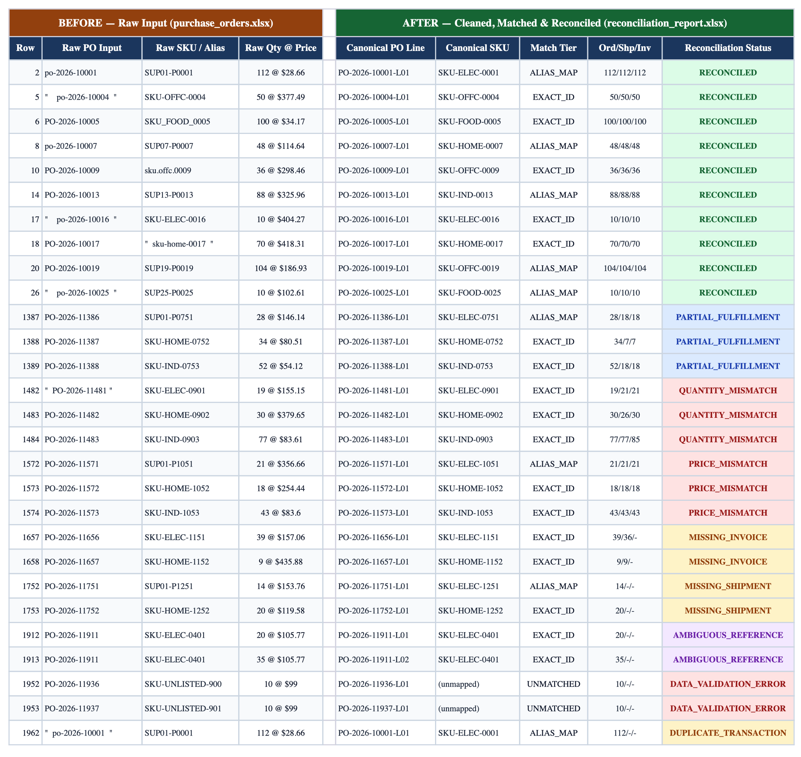
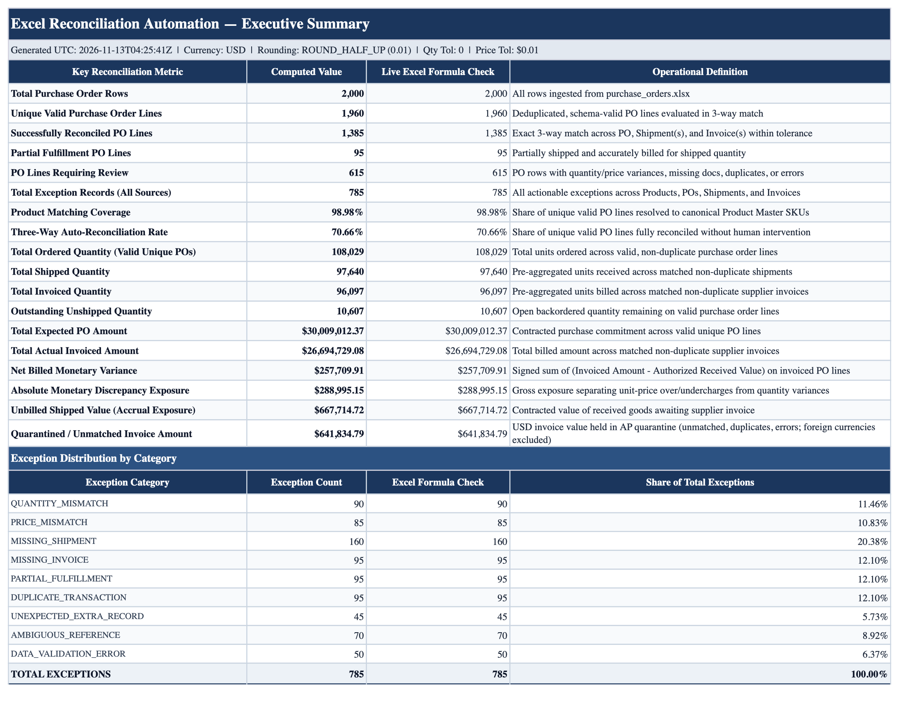
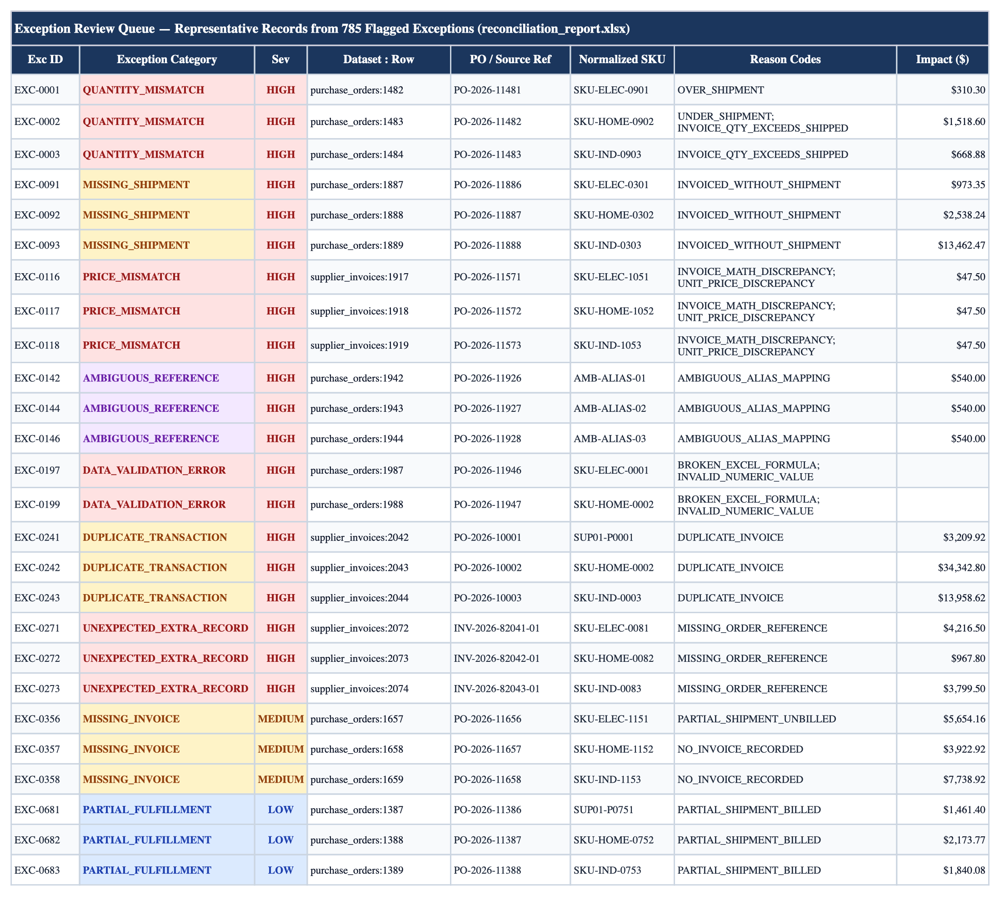
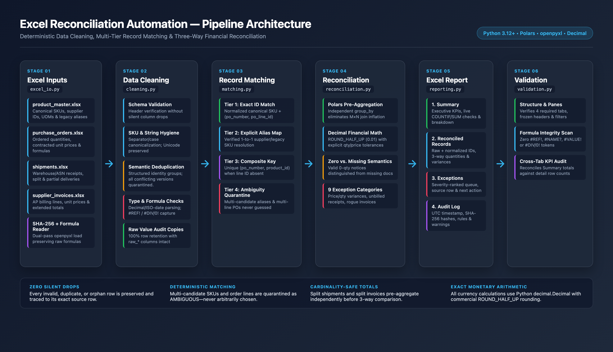

# Excel Reconciliation Automation

**Automated Data Cleaning, Record Matching & Financial Reconciliation with Python**

[](https://github.com/akaBoyLovesToCode/excel-reconciliation-automation/actions/workflows/ci.yml)
[](https://www.python.org/)
[](LICENSE)
[](https://docs.astral.sh/ruff/)

---

## 1. Project Overview

**Excel Reconciliation Automation** is a deterministic, auditable Python command-line application that automates multi-file financial and operational spreadsheet reconciliation for trading companies, e-commerce operations, procurement teams, and accounting departments.

Given four raw Excel exports from separate business systems—**Product Master**, **Purchase Orders**, **Shipments**, and **Supplier Invoices**—the pipeline normalizes inconsistent identifiers, resolves product aliases deterministically without guessing, performs cardinality-safe three-way matching using exact `decimal.Decimal` arithmetic, and produces a formatted, formula-checked, four-worksheet Excel workbook (`reconciliation_report.xlsx`) ready for finance and operations review.

---

## 2. Real-World Business Problem

In many small and mid-sized trading, wholesale, and e-commerce organizations, purchasing, warehouse receiving, and accounts payable teams operate across disconnected ERP portals, 3PL spreadsheets, and supplier billing exports. Before approving supplier payments or closing monthly accruals, analysts must verify that:

1. **What was ordered** (`purchase_orders.xlsx`) matches canonical catalog items (`product_master.xlsx`).
2. **What physically arrived** (`shipments.xlsx`) matches ordered quantities—even when split across multiple partial deliveries.
3. **What the supplier billed** (`supplier_invoices.xlsx`) matches received quantities and contracted unit prices.

Manual spreadsheet reconciliation with `VLOOKUP`, `XLOOKUP`, and pivot tables routinely breaks down under real operational data defects:

- **Inconsistent SKU formatting:** Leading/trailing spaces, mixed casing, and differing punctuation (`" sku_elec_0042 "`, `"SKU.ELEC.0042"`, `"SKU-ELEC-0042"`).
- **Supplier & legacy part aliases:** Vendors billing under legacy catalog codes rather than internal SKUs—including ambiguous aliases mapped to multiple active products.
- **Missing line references:** Shipments or invoices referencing a Purchase Order number (`PO-2026-01042`) without the line identifier (`PO-2026-01042-L01`).
- **One-to-many join inflation:** Naive table joins between 2 split shipments and 2 split invoices create $2 \times 2 = 4$ cross-product rows, silently doubling quantities and dollar totals.
- **Duplicate exports & corrupt cells:** Repeated batch rows, text-formatted numbers (`"$1,240.50"`, `"TBD"`), mixed date formats, and broken upstream Excel formulas (`#REF!`, `#DIV/0!`).

---

## 3. Automated Solution

Instead of brittle manual lookups or opaque scripts that silently drop malformed rows, this project implements a six-stage auditable pipeline:

1. **Dual-Pass Workbook Ingestion (`excel_io.py`):** Computes SHA-256 checksums of every input file, reads both raw formula strings (`data_only=False`) and cached values (`data_only=True`), distinguishes true Excel formula cells (`data_type == "f"`) from literal text beginning with `"="`, re-evaluates explicitly allowlisted intra-sheet arithmetic (`+`, `-`, `*`, `/`, `SUM`, `ROUND`) under bounded range/cell evaluation limits using Excel reference semantics (ignoring text-formatted numbers inside `SUM` ranges) regardless of cached Excel values, and flags unpermitted, oversized, or broken upstream formulas (`#REF!`, `#DIV/0!`, `#VALUE!`, `#NAME?`).
2. **Non-Destructive Data Cleaning (`cleaning.py`):** Validates required headers strictly (failing fast on missing required columns via `SchemaValidationError`), preserves every original input cell in `raw_*` columns, canonicalizes SKUs and Unicode descriptions, enforces bounded finite `decimal.Decimal` parsing and `ROUND_HALF_UP` quantization, standardizes dates, and separates identical duplicate exports from conflicting duplicates across structured business keys—retaining **100% of input records**.
3. **Deterministic 4-Tier Supplier-Aware Matching (`matching.py`):** Resolves products and order lines through strict priority tiers (`EXACT_ID` → `ALIAS_MAP` → `COMPOSITE_KEY` → `AMBIGUOUS` / `UNMATCHED` / `INVALID_KEY`). Conflicting catalog definitions (`CONFLICTING_MASTER_RECORD`), ambiguous aliases, supplier mismatches between invoices and POs (`SUPPLIER_MISMATCH`), and multi-candidate order-line collisions are quarantined rather than arbitrarily tie-broken.
4. **Cardinality-Safe 3-Way Reconciliation (`reconciliation.py`):** Pre-aggregates valid non-duplicate shipments (scoped by `ShipmentLineKey`) and supplier invoices (scoped by `InvoiceLineKey` and supplier identity) independently by structured `PoLineKey` in Polars *before* joining, eliminating $M \times N$ join inflation. Computes contracted amounts, signed billed variances, sequential non-double-counted discrepancy exposure (capturing simultaneous price and quantity errors), partial-invoicing accrual exposure, and quarantined invoice totals while distinguishing valid `0` quantities from missing documents.
5. **Injection-Safe Executive Excel Reporting (`reporting.py`):** Writes `reconciliation_report.xlsx` atomically via sibling temp files and `os.replace()` across four structured tabs (`Summary`, `Reconciled Records`, `Exceptions`, `Audit Log`). Escapes untrusted text cells starting with spreadsheet formula trigger prefixes (`=`, `+`, `-`, `@`, `\t`, `\r`, `\n`) as `data_type="s"` with `quotePrefix=True`, writes pure cross-sheet `Summary` check formulas, and populates consistent OpenXML `<v>` cached values.
6. **Post-Generation Formula & Workbook Validation (`validation.py`):** Re-opens the generated `.xlsx` file to verify worksheet presence, frozen panes, auto-filters, absence of rogue `<f>` elements outside authorized `Summary` formula cells, injection-safe quoting on all untrusted string cells, independent formula re-evaluation across all `38` `Summary` formulas, OpenXML `<v>` cache parity, and exact numeric KPI agreement.

---

## 4. Key Features

- **Zero Silent Data Loss:** Invalid rows, duplicate or conflicting exports, unmapped SKUs, currency/supplier mismatches, and orphan shipments/invoices are never discarded; every anomaly is routed to the `Exceptions` queue with its exact source file and row number.
- **Ambiguity & Conflict Quarantine:** Conflicting catalog definitions, multi-target aliases, supplier mismatches, and unlined shipments referencing multi-line POs are quarantined (`AMBIGUOUS_REFERENCE` / `UNEXPECTED_EXTRA_RECORD` / `DATA_VALIDATION_ERROR`) rather than guessed.
- **Exact Financial Precision & Exposure Accounting:** All unit prices, line totals, variances, simultaneous price/quantity exposures, and partial-invoicing accruals use Python `decimal.Decimal` with commercial `ROUND_HALF_UP` rounding (`excel_round`) and bounded input validation.
- **Formula Safety & Injection Defense:** Input formulas are restricted to an `ast` arithmetic allowlist, original PO formulas are rendered safely for audit display without becoming executable report formulas, untrusted text beginning with formula triggers (`=`, `+`, `-`, `@`, `\t`, `\r`, `\n`) is written as literal `quotePrefix=True` text cells, and `Summary` cached `<v>` values match recalculated Python results.
- **Deterministic Synthetic Benchmark Generator:** Includes a seeded generator (`demo_data.py`) producing 7,800 synthetic records across four workbooks alongside a machine-verifiable `ground_truth.json` manifest.

---

## 5. Before-and-After Screenshots & Architecture

All spreadsheet visuals below are rendered directly from actual `.xlsx` workbooks produced by the pipeline (never hand-drawn UI mockups):

### Before & After: Messy Raw Export vs. Cleaned & Reconciled Output



### Executive Summary Dashboard (`Summary` Worksheet)



### Severity-Ranked Exception Review Queue (`Exceptions` Worksheet)



### Six-Stage Pipeline Architecture



A standalone three-page engineering & business case study is also compiled to [`portfolio/case_study.pdf`](portfolio/case_study.pdf). To regenerate all four visuals and the PDF case study on macOS:

```bash
PYTHONPATH=src python scripts/build_portfolio.py
```

---

## 6. Example Processing Results (Synthetic Dataset)

> **Synthetic Data Notice:** All company names, supplier IDs, SKUs, purchase orders, shipments, and invoices in this repository are **100% synthetic**, deterministically generated with `seed=20260401` (`src/excel_reconciliation/demo_data.py`). All figures below come from actual pipeline execution.

### Input Cohort Volumes (`seed=20260401`)

| Workbook | Rows | Valid Unique Rows | Injected Real-World Scenarios |
|---|---:|---:|---|
| `product_master.xlsx` | 1,500 | 1,485 | Canonical SKUs, 10 duplicate exports, 5 invalid cost rows, legacy aliases, multi-SKU alias collisions, Unicode descriptions (`Café`, `Précision`) |
| `purchase_orders.xlsx` | 2,000 | 1,960 | Whitespace/punctuation SKU noise, supplier alias usage, 25 duplicate PO lines, 15 malformed numeric/date/formula rows (`#DIV/0!`), live `=G*H` formulas |
| `shipments.xlsx` | 2,200 | 2,148 | Split deliveries (multiple shipments per PO line), partial backorders, composite-key lookups (missing `po_line_id`), 30 duplicate ASN rows, orphan receipts, valid `0`-qty notices |
| `supplier_invoices.xlsx` | 2,100 | 2,050 | Exact 3-way bills, unit-price overcharges, over-billed quantities, premature invoices without shipment, internal `qty * price != line_amount` math errors, 30 duplicate invoices, rogue bills |

### Executed Summary KPIs (`reconciliation_report.xlsx`)

| Metric | Executed Value |
|---|---:|
| Total Purchase Order Rows Ingested | `2,000` |
| Unique Valid Purchase Order Lines | `1,960` |
| Product Matching Coverage (`EXACT_ID` + `ALIAS_MAP`) | `98.98%` (`1,940 / 1,960`) |
| Three-Way Auto-Reconciled PO Lines | `1,385` (`70.66%`) |
| Partial Fulfillment PO Lines | `95` (`4.85%`) |
| PO Lines Requiring Operational Review | `615` |
| Total Exception Records (Across All 4 Datasets) | `785` |
| Total Ordered / Shipped / Invoiced Units | `108,029` / `97,640` / `96,097` |
| Outstanding Unshipped Backorder Units | `10,607` |
| Total Expected PO Commitment | `$30,009,012.37` |
| Total Actual Invoiced Amount | `$26,694,729.08` |
| Net Billed Monetary Variance (vs. Authorized Receipts) | `$257,709.91` |
| Gross Monetary Discrepancy Exposure | `$288,995.15` |
| Unbilled Shipped Accrual Exposure | `$667,714.72` |
| Quarantined / Unmatched Invoice Amount | `$641,834.79` |

### Deterministic Purchase Order Line Outcomes (`2,000` Rows)

Every one of the 2,000 Purchase Order rows is classified deterministically and verified against `examples/input/ground_truth.json` (`expected_po_status_by_source_row` across all 2,000 source rows, `expected_financial_totals`, `expected_duplicate_counts`, and `expected_exception_counts_by_dataset` totaling `785` exceptions across `product_master: 15`, `purchase_orders: 530`, `shipments: 80`, `supplier_invoices: 160`):

| Reconciliation Status | PO Row Count | Share of Total PO Rows | Share of Unique Valid PO Lines (`1,960`) |
|---|---:|---:|---:|
| `RECONCILED` | 1,385 | 69.25% | 70.66% |
| `MISSING_SHIPMENT` | 160 | 8.00% | 8.16% |
| `PARTIAL_FULFILLMENT` | 95 | 4.75% | 4.85% |
| `MISSING_INVOICE` | 95 | 4.75% | 4.85% |
| `QUANTITY_MISMATCH` | 90 | 4.50% | 4.59% |
| `PRICE_MISMATCH` | 85 | 4.25% | 4.34% |
| `AMBIGUOUS_REFERENCE` | 40 | 2.00% | 2.04% |
| `DATA_VALIDATION_ERROR` | 25 | 1.25% | *(15 PO-level invalid + 10 unmapped SKUs)* |
| `DUPLICATE_TRANSACTION` | 25 | 1.25% | *(Excluded from open commitment totals)* |
| **Total** | **2,000** | **100.00%** | — |

In addition to Purchase Order line exceptions, the `Exceptions` worksheet captures duplicate Product Master rows, duplicate/orphan/ambiguous Shipments, and duplicate/orphan/ambiguous Supplier Invoices across all four input files.

---

## 7. Technology Stack

| Component | Purpose in Architecture |
|---|---|
| **Python 3.12+** | Core language (`dataclasses`, `StrEnum`, `decimal.Decimal`, `pathlib`, `argparse`, `hashlib`, `ast`) |
| **Polars** | Fast, expressive DataFrame cleaning pipelines, semantic duplicate grouping with conflict quarantine, and independent pre-aggregation preventing join-cardinality inflation |
| **openpyxl** | Dual-pass Excel reading (preserving raw formulas alongside values), corporate report styling, conditional formatting, auto-filters, frozen panes, and live Excel summary formulas |
| **pytest** | Unit, edge-case, cardinality-regression, CLI, workbook-validation, and 7,800-row ground-truth end-to-end test suite |
| **Ruff** | Strict linting (`E`, `W`, `F`, `I`, `B`, `C4`, `UP`, `SIM`, `RUF`) and code formatting |

No external APIs, databases, cloud services, web frameworks, or LLMs are required; the entire workflow executes locally and deterministically offline.

---

## 8. Quick-Start Instructions

### Option A: Portable Setup for External Users (Standard `venv` or `uv`)

Clone the repository and install declared dependencies in an isolated virtual environment:

```bash
git clone https://github.com/akaBoyLovesToCode/excel-reconciliation-automation.git
cd excel-reconciliation-automation

python3 -m venv .venv
source .venv/bin/activate
python -m pip install --upgrade pip
python -m pip install -e ".[dev]"
```

Run the demonstration pipeline end to end:

```bash
# 1. Generate 4 synthetic Excel workbooks + ground_truth.json in examples/input/
python -m excel_reconciliation generate-demo

# 2. Clean, match, and reconcile inputs into examples/output/reconciliation_report.xlsx
python -m excel_reconciliation reconcile --input examples/input --output examples/output

# 3. Validate worksheet structure, formula integrity, and cross-sheet KPI parity
python -m excel_reconciliation validate --report examples/output/reconciliation_report.xlsx
```

Optional CLI flags for custom tolerances and machine-readable JSON metrics:

```bash
python -m excel_reconciliation reconcile \
  --input examples/input \
  --output examples/output \
  --qty-tolerance 0 \
  --price-tolerance 0.01 \
  --amount-tolerance 0.02 \
  --summary-json examples/output/summary_metrics.json
```

### Option B: Nix / Home Manager Workflow (Direct or Ephemeral Nix Shell)

On NixOS or macOS with Nix Home Manager, run directly without virtual environments (either with packages in your Nix profile or via an ephemeral `nix-shell`):

```bash
nix-shell -p 'python313.withPackages (ps: with ps; [ polars openpyxl pytest ])' ruff --run '
  export PYTHONPATH=src
  python -m excel_reconciliation generate-demo
  python -m excel_reconciliation reconcile --input examples/input --output examples/output
  python -m excel_reconciliation validate --report examples/output/reconciliation_report.xlsx
  ruff check .
  ruff format --check .
  python -m pytest -v
'
```

*(Note: `pyproject.toml` already configures `pythonpath = ["src"]` for `pytest`.)*

---

## 9. Input & Output File Formats

### Required Input Workbooks (`--input` directory)

| Filename | Required Columns |
|---|---|
| `product_master.xlsx` | `product_id`, `canonical_sku`, `product_name`, `category`, `uom`, `standard_cost`, `supplier_id`, `aliases`, `active_flag` |
| `purchase_orders.xlsx` | `po_number`, `po_line_id`, `order_date`, `supplier_id`, `sku`, `product_description`, `ordered_qty`, `unit_price`, `currency`, `line_total` |
| `shipments.xlsx` | `shipment_id`, `po_number`, `po_line_id`, `ship_date`, `carrier`, `tracking_ref`, `sku`, `shipped_qty`, `warehouse_code` |
| `supplier_invoices.xlsx` | `invoice_id`, `invoice_line_id`, `po_number`, `po_line_id`, `invoice_date`, `supplier_id`, `sku`, `invoiced_qty`, `unit_price`, `line_amount`, `currency` |

Extra informational columns in customer workbooks are tolerated; missing required columns fail fast with an explicit schema error before processing.

### Generated Output Workbook (`reconciliation_report.xlsx`)

1. **`Summary`** — Executive KPI scorecard covering all `18` summary KPIs (total PO rows, unique valid PO lines, reconciled lines, partial fulfillment lines, matching coverage %, auto-reconciliation %, ordered/shipped/invoiced/outstanding quantities, expected vs. invoiced dollar totals, net billed variance, absolute discrepancy exposure, unbilled accrual exposure, and quarantined/unmatched invoice amount), paired with `38` live cross-sheet Excel check formulas (`COUNTA`, `COUNTIF`, `COUNTIFS`, `SUM`, `SUMIF`, `SUMIFS`, `IF`, `ROUND`), synchronized OpenXML `<v>` cached values, and an exception category distribution table.
2. **`Reconciled Records`** — Complete `30`-column line-by-line ledger of all Purchase Order rows showing source row numbers, raw input identifiers alongside normalized identifiers, matched canonical SKU and structured `PoLineKey`, match tier, ordered/shipped/invoiced/outstanding quantities, contracted vs. billed amounts, monetary variance against authorized receipts, shipment/invoice document counts and IDs, preserved original PO formula text, reconciliation status, reason codes, `Valid PO Line` flag, `Discrepancy Exposure`, and `Unbilled Receipt Accrual`.
3. **`Exceptions`** — Severity-prioritized (`HIGH` → `MEDIUM` → `LOW`) operations queue across all four datasets, listing Exception ID, Category, Severity, Source Dataset, Source Row, PO/Document References, Raw & Normalized SKUs, Reason Codes, Quantity & Monetary Impact, human-readable Explanation, and Suggested Next Action. Untrusted string cells are written with literal `data_type="s"` and `quotePrefix=True` when starting with spreadsheet formula triggers.
4. **`Audit Log`** — Run timestamp (UTC), runtime versions, reporting currency and active tolerance & rounding parameters, SHA-256 checksums and formula counts for all four input files, deterministic matching rules applied, schema/cleaning summaries, and processing warnings.

---

## 10. Reconciliation Rules & Financial Semantics

### Matching Priority Hierarchy & Supplier Isolation

Both product resolution (`ProductMatcher`) and order-line linkage (`OrderLineMatcher`) follow four deterministic tiers:

1. **Tier 1 — `EXACT_ID`:** Normalized SKU matches a unique non-conflicting `canonical_sku` in Product Master; normalized `(po_number, po_line_id)` matches a unique valid Purchase Order line (and for supplier invoices, `supplier_id` matches the target PO's `supplier_id`).
2. **Tier 2 — `ALIAS_MAP`:** Normalized SKU matches an explicit, unambiguous 1-to-1 entry in `product_master.aliases`.
3. **Tier 3 — `COMPOSITE_KEY`:** When `po_line_id` is blank on a Shipment or Invoice, `(normalized_po_number, matched_product_id)` resolves to a PO line **only if** that Purchase Order contains exactly one valid non-duplicate line for that product (and supplier verification passes for invoices).
4. **Tier 4 — `AMBIGUOUS` / `UNMATCHED` / `INVALID_KEY`:** If a canonical SKU has conflicting catalog definitions (`CONFLICTING_MASTER_RECORD`), an alias maps to $\ge 2$ products, a composite lookup matches $\ge 2$ lines on the same PO, or an invoice's `supplier_id` disagrees with the PO (`SUPPLIER_MISMATCH`), the record is quarantined and never guessed.

### Structured Business Keys & Semantic Deduplication

- **Collision-Free Business Keys:** Purchase Order lines are keyed by structured `PoLineKey(po_number, po_line_id)` rather than unescaped string concatenation (`PO ("A::B", "C")` never collides with `PO ("A", "B::C")`), with injective escaped display formatting.
- **Explicit Transaction Identities:** Shipments are deduplicated by `ShipmentLineKey(shipment_id, order_scope_kind, po_number, po_line_id, product_key)` after SKU alias resolution, preserving legitimate split shipments while isolating shared `shipment_id`s across different PO lines. Supplier invoices are scoped by `InvoiceLineKey(supplier_id, invoice_id, invoice_line_id)` so distinct suppliers cannot collide on identical invoice numbers.
- **Identical vs. Conflicting Duplicates:** Repeated rows with identical semantic values are flagged cleanly as `DUPLICATE_*`, whereas repeated keys with differing quantities, prices, products, or attributes are flagged distinctly as `CONFLICTING_DUPLICATE_*` (`HIGH` severity) and deterministically quarantined from aggregations.

### Rounding, Financial Formulas & Default Tolerances

- **Monetary Arithmetic:** High-precision intermediate `decimal.Decimal` (`ARITHMETIC_CONTEXT`) quantized to `0.01` using commercial `decimal.ROUND_HALF_UP` (`excel_round`).
- **Authorized Receipt Baseline ($Q_{\text{auth}}$):** Equal to $\min(Q_{\text{shipped}}, Q_{\text{ordered}})$, where $Q_{\text{shipped}} = 0$ when no valid shipment is recorded (so premature invoices without shipment have $Q_{\text{auth}} = 0$ and 100% unauthorized billed quantity).
- **Sequential Capacity Allocation:** Initializing $R = Q_{\text{auth}}$, each matched valid invoice line $j$ (in deterministic source order) is partitioned into supported units $q_{\text{supp},j} = \min(q_j, R)$ (updating $R \leftarrow R - q_{\text{supp},j}$) and excess billed units $q_{\text{exc},j} = q_j - q_{\text{supp},j}$, splitting billed amount $a_j$ into $a_{\text{supp},j} = \text{round}(a_j \cdot q_{\text{supp},j} / q_j, 2)$ (for $q_j > 0, q_{\text{exc},j} > 0$; $0$ if $q_j = 0, q_{\text{exc},j} > 0$; $a_j$ if $q_{\text{exc},j} = 0$) and $a_{\text{exc},j} = \text{round}(a_j - a_{\text{supp},j}, 2)$, against contracted value $v_{\text{supp},j} = \text{round}(q_{\text{supp},j} \cdot P_{\text{po}}, 2)$.
- **Net Billed Monetary Variance (`monetary_variance`):** Computed on invoiced PO lines via `compute_po_line_financials` as $A_{\text{inv}} - \sum_j v_{\text{supp},j}$ (`None` when unbilled), ensuring accurately billed partial shipments carry `$0.00` variance.
- **Gross Monetary Discrepancy Exposure (`discrepancy_exposure`):** Sums $|\Delta_{\text{price},j}| + |\Delta_{\text{qty},j}|$ across matched invoices where $\Delta_{\text{price},j} = a_{\text{supp},j} - v_{\text{supp},j}$ and $\Delta_{\text{qty},j} = a_{\text{exc},j}$ whenever unit-price, invoice-math, or over-billing/premature-billing discrepancies exceed tolerances (or $|L_{\text{po}} - \text{round}(Q_{\text{ordered}} \cdot P_{\text{po}}, 2)|$ for standalone PO math errors; `$0.00` otherwise). Because $\sum_j (\Delta_{\text{price},j} + \Delta_{\text{qty},j}) = \text{monetary\_variance}$, simultaneous opposite-sign price and quantity errors are captured in full without double counting over-billed units.
- **Unbilled Shipped Accrual Exposure (`unbilled_receiving_amount`):** Computed as $\text{round}(\max(Q_{\text{auth}} - Q_{\text{invoiced}}, 0) \cdot P_{\text{po}}, 2) = \text{round}(R \cdot P_{\text{po}}, 2)$, capturing both completely unbilled receipts (`MISSING_INVOICE`) and partially invoiced receipts.
- **Quarantined / Unmatched Invoice Amount (`quarantined_invoice_amount`):** Sum of valid `line_amount` values in the configured reporting currency (default `USD`) across quarantined `supplier_invoices` exceptions (excluding matched `PRICE_MISMATCH` lines already counted in `Total Actual Invoiced Amount`). Non-reporting-currency rows (`EUR`, `GBP`, etc.) are excluded from `USD` totals without FX conversion while preserving their original amounts and currency codes in `Exceptions` details.
- **Default Tolerances:** `--qty-tolerance 0` (`|qty_a - qty_b| <= 0`), `--price-tolerance 0.01` (`|invoice_unit_price - po_unit_price| <= 0.01`), and `--amount-tolerance 0.02` (`|invoiced_amount - expected_shipped_amount| <= 0.02`).

### Cardinality-Safe Aggregation & Zero-Value Semantics

- **Pre-Aggregation Against Join Inflation:** Valid, non-duplicate shipments and supplier invoices matched to a PO line are grouped independently by structured `(po_number, po_line_id)` (`PoLineKey`) before 3-way comparison. A PO line fulfilled in 3 split shipments and billed across 2 split invoices aggregates accurately without $3 \times 2$ row multiplication.
- **Zero vs. Missing Distinction:** An explicit `0` quantity row (such as a confirmed zero-quantity cancellation notice + `$0.00` zero memo on a `0`-qty cancelled PO line) is preserved as `Decimal("0")` (`ZERO_VALUE_CONFIRMED`), whereas an absent shipment or invoice remains `None` (`NO_SHIPMENT_RECORDED` / `NO_INVOICE_RECORDED`).

---

## 11. Exception Handling Reference

| Exception Category | Primary Reason Codes | Severity | Operational Next Action |
|---|---|---|---|
| `DATA_VALIDATION_ERROR` | `INVALID_NUMERIC_VALUE`, `NEGATIVE_QUANTITY_OR_PRICE`, `INVALID_DATE_VALUE`, `BROKEN_EXCEL_FORMULA`, `UNPERMITTED_EXCEL_FORMULA`, `UNKNOWN_SKU`, `CURRENCY_MISMATCH` | `MEDIUM` / `HIGH` | Correct malformed cells, non-allowlisted/broken formulas, currency mismatches, or unmapped SKUs in source export. |
| `DUPLICATE_TRANSACTION` | `DUPLICATE_PRODUCT_ROW`, `DUPLICATE_PO_LINE`, `DUPLICATE_SHIPMENT`, `DUPLICATE_INVOICE`, `CONFLICTING_DUPLICATE_PO_LINE`, `CONFLICTING_DUPLICATE_SHIPMENT`, `CONFLICTING_DUPLICATE_INVOICE` | `LOW` / `MEDIUM` / `HIGH` | Deduplicate ERP/WMS/AP export; investigate conflicting duplicates (`HIGH`) and block duplicate supplier invoices from payment. |
| `AMBIGUOUS_REFERENCE` | `AMBIGUOUS_MASTER_SKU`, `AMBIGUOUS_ALIAS_MAPPING`, `CONFLICTING_MASTER_RECORD`, `MULTIPLE_CANDIDATE_PO_LINES`, `AMBIGUOUS_TRANSACTION_LINK`, `LINE_PRODUCT_CONFLICT` | `MEDIUM` / `HIGH` | Resolve conflicting catalog rows, disambiguate aliases in Product Master, or assign explicit `po_line_id`. |
| `UNEXPECTED_EXTRA_RECORD` | `MISSING_ORDER_REFERENCE`, `UNKNOWN_PO_NUMBER`, `PRODUCT_NOT_ON_PO`, `SUPPLIER_MISMATCH` | `MEDIUM` / `HIGH` | Place AP hold on unreferenced/supplier-mismatched supplier invoice or investigate unrecorded warehouse receipt. |
| `MISSING_SHIPMENT` | `NO_SHIPMENT_RECORDED`, `INVOICED_WITHOUT_SHIPMENT` | `MEDIUM` / `HIGH` | Follow up with supplier on overdue PO, or block premature invoice (`HIGH`) lacking warehouse receipt. |
| `MISSING_INVOICE` | `NO_INVOICE_RECORDED`, `PARTIAL_SHIPMENT_UNBILLED` | `MEDIUM` | Accrue unbilled received/partially-invoiced inventory liability at period close and request supplier invoice. |
| `PRICE_MISMATCH` | `UNIT_PRICE_DISCREPANCY`, `INVOICE_MATH_DISCREPANCY`, `PO_MATH_DISCREPANCY` | `HIGH` | Hold invoice for buyer review or request supplier credit memo to match contracted PO unit price. |
| `QUANTITY_MISMATCH` | `OVER_SHIPMENT`, `UNDER_SHIPMENT`, `INVOICE_QTY_EXCEEDS_SHIPPED`, `INVOICE_QTY_MISMATCH` | `HIGH` | Reconcile dock receiving count against supplier bill or approve over-shipment amendment. |
| `PARTIAL_FULFILLMENT` | `PARTIAL_SHIPMENT_BILLED` | `LOW` | Approve partial invoice matching received units and keep remaining backordered balance open. |

---

## 12. Testing & Quality Assurance

The automated `pytest` suite (`tests/`) covers unit, integration, regression, independent-invariant, and end-to-end validation scenarios:

- **`tests/test_cleaning.py`** — Whitespace/Unicode/SKU normalization, currency & negative-parentheses `Decimal` parsing, bounded `Decimal` validation, locale-independent date parsing, fail-fast `SchemaValidationError` checking, identical vs. conflicting duplicate separation (POs, shipments with shared IDs and alias resolution, supplier-scoped invoices), AST input-formula allowlisting, and literal `"="` text preservation.
- **`tests/test_matching.py`** — Exact SKU matching, conflicting canonical SKU catalog quarantine, 1-to-1 alias resolution, multi-SKU alias ambiguity quarantine, composite `(po_number, product_id)` matching, multi-line composite ambiguity quarantine, supplier-aware invoice matching (`SUPPLIER_MISMATCH`), and cross-PO SKU mismatch detection.
- **`tests/test_reconciliation.py`** — Exact 3-way match, **3 shipments $\times$ 2 invoices join-cardinality regression test**, `PoLineKey` delimiter collision regression (`A::B` | `C` vs. `A` | `B::C`), `ROUND_HALF_UP` penny-rounding tests, duplicate/conflicting shipment & invoice inflation regression tests, price mismatch provenance (`supplier_invoices`), simultaneous price + quantity discrepancy exposure, partial fulfillment, partial invoicing accrual, mixed-currency `CURRENCY_MISMATCH` quarantine, premature invoice without shipment, orphan extra invoice, and zero-value vs. missing record handling.
- **`tests/test_reporting.py`** — Dual-pass formula preservation, intra-sheet formula evaluation, spreadsheet formula injection sanitization (`=`, `+`, `-`, `@`, `\t`, `\r`, `\n` written as `data_type="s"` with `quotePrefix=True`), safe string escaping of broken input formulas (`#DIV/0!`), independent formula re-evaluation, OpenXML `<v>` cache consistency, atomic report replacement, and corruption detection in `validate_report_workbook`.
- **`tests/test_invariants.py`** — Hand-calculated verification of nine independent business invariants (no double counting of shipments or invoices, supplier isolation, collision-free PO line identities, quarantined exclusion from valid totals, source-to-summary conservation, non-omission of simultaneous discrepancies, Excel formula vs. Python KPI parity, and exact source-row traceability).
- **`tests/test_demo_data.py`** — Seed determinism (`seed=20260401`), exact cohort sizes (`1,500` / `2,000` / `2,200` / `2,100`), conflicting duplicate & alias scenarios, and agreement against `ground_truth.json` across all 2,000 PO source rows, financial totals, and dataset exception counts.
- **`tests/test_cli.py`** — End-to-end CLI subcommands (`generate-demo`, `reconcile`, `validate`), JSON summary export, `SchemaValidationError` and missing-input exit codes, and missing-dependency diagnostics.

Continuous Integration (`.github/workflows/ci.yml`) runs `ruff check .`, `ruff format --check .`, `python -m pytest -v`, and the full `generate-demo` → `reconcile` → `validate` CLI pipeline across Python 3.12 and Python 3.13 on every push and pull request.

---

## 13. Project Architecture

```text
excel-reconciliation-automation/
├── README.md
├── LICENSE
├── pyproject.toml
├── .gitignore
├── .github/
│   └── workflows/
│       └── ci.yml                  # Reproducible lint, format, pytest & CLI smoke CI
├── scripts/
│   └── build_portfolio.py          # Renders genuine .xlsx screenshots, diagram & PDF case study
├── src/
│   └── excel_reconciliation/
│       ├── __init__.py             # Package version metadata
│       ├── __main__.py             # Enables `python -m excel_reconciliation`
│       ├── cli.py                  # argparse CLI (generate-demo, reconcile, validate)
│       ├── models.py               # Typed StrEnums, tolerances, Decimal rounding & dataclasses
│       ├── excel_io.py             # SHA-256 hashing, dual-pass openpyxl reader & AST formula evaluator
│       ├── cleaning.py             # String/SKU/Decimal/date normalizers & Polars cleaning pipelines
│       ├── matching.py             # Deterministic 4-tier ProductMatcher & OrderLineMatcher
│       ├── reconciliation.py       # Polars pre-aggregation & 3-way Decimal reconciliation engine
│       ├── reporting.py            # 4-tab openpyxl report builder with live check formulas
│       ├── validation.py           # Post-generation workbook structure, formula & KPI validator
│       └── demo_data.py            # Seeded 7,800-row synthetic business data & ground-truth builder
├── examples/
│   ├── input/                      # Synthetic or customer Excel workbooks + ground_truth.json
│   └── output/                     # Generated reconciliation_report.xlsx
├── portfolio/
│   ├── 01_before_after.png         # Rendered raw vs. cleaned/reconciled comparison
│   ├── 02_summary_dashboard.png    # Rendered Executive Summary worksheet
│   ├── 03_exception_report.png     # Rendered Exceptions review queue
│   ├── 04_workflow.png             # Six-stage pipeline architecture diagram
│   └── case_study.pdf              # Three-page technical & business case study
└── tests/
    ├── conftest.py
    ├── test_cleaning.py
    ├── test_matching.py
    ├── test_reconciliation.py
    ├── test_reporting.py
    ├── test_invariants.py
    ├── test_demo_data.py
    ├── test_third_review.py
    └── test_cli.py
```

---

## 14. Limitations & Assumptions

- **Single-Currency Batch Assumption:** Each reconciliation batch enforces a single configured reporting currency (default `USD`). Multi-currency FX conversion is intentionally out of scope; records denominated in any other currency are explicitly quarantined with `CURRENCY_MISMATCH` (`DATA_VALIDATION_ERROR`) so totals never blend un-converted currencies.
- **Synthetic Demonstration Dataset:** All sample workbooks in `examples/input/` (`seed=20260401`) and portfolio visuals/PDF benchmarks are 100% synthetic rather than live customer ERP records.
- **Allowlisted Formula Scope:** During input ingestion (`excel_io.py`), only intra-sheet arithmetic (`+`, `-`, `*`, `/`, cell references, `SUM` following Excel reference type semantics, `ROUND`, and numeric literals) is evaluated via Python `ast` within configurable range/cell evaluation limits (`100,000` cells per range / `250,000` evaluated cells per formula by default); external links, oversized ranges, and unsupported Excel functions are flagged (`UNPERMITTED_EXCEL_FORMULA` / `#VALUE!`) regardless of whether cached values were saved by Excel. Permitted formulas are re-evaluated; unsupported formulas are rejected even when cached values are present. Likewise, `validate_report_workbook` evaluates the deterministic formula subset used in `Summary` (`COUNTA`, `COUNTIF`, `COUNTIFS`, `SUM`, `SUMIF`, `SUMIFS`, `IF`, `ROUND`) under explicit configurable `FormulaEvaluationLimits`.
- **Report Validation Scope:** Validation checks the generated report contract and cross-sheet consistency. Authenticating source rows or recomputing invoice allocations requires the original workbooks. Editor-resaved files may alter formula/data types and quote-prefix metadata.
- **First-Worksheet Ingestion & Deterministic Non-Fuzzy Matching:** Each input `.xlsx` file is read from its active/first worksheet with column headers in row 1. Fuzzy string matching on descriptions is intentionally excluded; unmapped SKUs are routed to `Exceptions` until added to `product_master.aliases`.
- **In-Memory Batch Sizing & Portfolio Assets:** The demonstrated batch contains 7,800 rows across four inputs. Formula evaluation is bounded; the default coverage check exceeds its 250,000-cell budget at 62,501 PO rows. Larger batches require deliberate resource-limit configuration and separate measurement. Regenerating PNG screenshots (`01`–`03`) via `scripts/build_portfolio.py` uses macOS QuickLook (`qlmanage`), while `04_workflow.png` and `case_study.pdf` require Google Chrome / Chromium headless binaries.

---

## License

Released under the [MIT License](LICENSE). Copyright (c) Corey Zhou ([coreyzhou.com](https://coreyzhou.com)).
